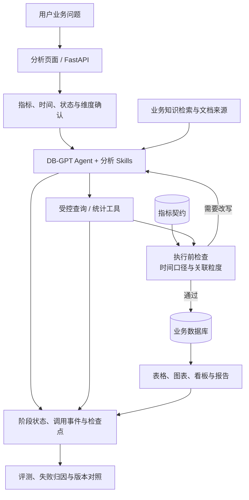

# DataTrail 设计说明

初版：2026-11-07。更新：2026-11-13。部署方式、开关和实验结果见 [DATATRAIL.md](DATATRAIL.md)。

## 1. 定位

基于 DB-GPT 构建的经营分析助手：把业务问题转成口径明确的查询和多步分析，结合业务文档生成可追溯的图表、看板与报告，记录执行过程，并检查计算错误。

主要用户是运营、经营分析和技术支持人员。

## 2. 为什么选择 DB-GPT

上游：https://github.com/eosphoros-ai/DB-GPT ，固定提交 `9d50d0a55071a040a8cb7684b3b6acfa13cc7c47`。

- 核心后端是 Python。
- 已有数据源、SQL、Agent 工具、Skills、知识接入、图表和报告模块，可以直接组成完整应用。
- 自带 Olist 数据的下载校验、导入、参考查询和指标说明，能较快建立可核查的数据基础。
- 可以在真实模块里加入诊断、上下文和执行策略，并逐项比较效果。
- 数据层用 SQLite 即可验证，不需要训练模型或 GPU。

取舍：上游规模大、依赖复杂，所以不重写底座。先打通一条分析链路，再修改与目标直接相关的模块。如果底座无法稳定运行，保留同一套业务约定、数据和评测，改用轻量服务实现。

相关源码入口：

| 层 | 底座入口 | 用途 |
|---|---|---|
| 服务 | `packages/dbgpt-app/src/dbgpt_app/openapi/api_v1/agentic_data_api.py` | Agent 请求、工具组织和流式响应 |
| 查询 | 同目录 `tools/sql_query.py` | 数据查询、超时、输出控制和执行捕获 |
| SQL 检查 | 同目录 `dashboard/sql_security.py` | AST 解析、只读约束、参数处理 |
| 报告 | 同目录 `tools/report_evidence.py`、`report_binding.py` | 结果证据与报告绑定 |
| 数据 | `examples/dashboard/olist/` | 公开数据、加载与参考答案 |
| 业务定义 | `examples/olist/olist-analytics-metric-governance.md` | 指标、时间、状态与粒度约定 |
| 页面 | `web/` | Next.js / React / TypeScript 交互与可视化 |

## 3. 功能范围

### 第一阶段：问数与可复查结果（已完成）

- 查询商品金额、支付金额、订单量和客单价等定义明确的指标。
- 按月份、地区、品类聚合和对比。
- 展示 SQL、时间范围、状态过滤和实际查询结果。
- 问题含糊时追问，数据不支持时明确说明。
- 诊断多表关联对金额和订单粒度的影响。

示例：“比较两个月已交付订单的商品金额、订单量和客单价，看看变化主要来自哪些地区。”

### 第二阶段：分析与图表报告

- 根据中间结果选择下一步查询，在有限次数内下钻。
- 用 pandas 做输入明确的统计，用底座的图表和报告能力交付。
- 检查分项与总量、报告数字与查询证据是否一致。
- 把变化贡献、相关性和原因假设分开表述。

### 第三阶段：业务文档与执行可靠性

- 检索指标文档、业务说明和操作规范，同时展示文档来源与 SQL 证据。
- 多步任务的阶段状态、失败分类、超时预算、检查点与恢复。
- 保存历史报告，用固定任务发现改动造成的退化。
- 数据源授权和查询约束通过现有扩展点接入，按具体访问矩阵验收。

### 第四阶段：反馈驱动迭代

- 从失败轨迹中提取候选分析经验，标注版本和适用条件。
- 对一个 Skill 或上下文策略做人工改进与自动改进的对照。
- 根据封存任务的结果决定接受、撤销或继续试验。

## 4. 技术选型

| 责任 | 技术 | 决策 |
|---|---|---|
| 后端 | Python、FastAPI、Pydantic | 沿用 DB-GPT 服务接口 |
| 模型 | OpenAI 兼容接口 | 固定一个实际可用的模型，模型名与参数记入实验 |
| Agent | DB-GPT Agent/ReAct、Tool Calling、Skills | 使用已有运行时，不叠加第二套框架 |
| 业务数据 | SQLite、SQLAlchemy；按需要接 MySQL | 先完成一个数据库，再验证方言迁移 |
| 结构与查询 | Schema 描述、sqlglot、只读连接、查询预算 | 语法限制和业务正确性分开处理 |
| 指标契约 | Pydantic 模型 + 每个数据库一份 JSON | 业务规则与检查代码分离，换库只加配置 |
| 统计 | SQL、pandas | 精确计算交给可复查的执行结果 |
| 知识检索 | DB-GPT 知识接口、Embedding，按任务需要加混合检索和重排 | 先沿用可运行方案 |
| 前端 | 底座 Next.js、React、TypeScript、图表组件、流式响应 | 先接通现有页面，再改分析详情与历史任务 |
| 状态与观测 | 阶段状态、SQL/工具事件、任务持久化、usage 与耗时 | 先本地留档，需要时接 Langfuse 等服务 |
| 外部工具 | MCP | 出现独立工具服务或跨应用复用需求后接入 |
| 验证 | pytest、数据不变量、独立参考计算、逐题对照 | 数据、工具合同、模型任务分层统计 |
| 部署 | 独立 Python 环境；后续 Docker Compose | 完整服务跑通后验证干净环境部署 |

## 5. 执行架构

模型负责选择和解释，程序负责执行约束、状态记录和可以明确判定的检查。检查结果未知或超出支持范围时，返回风险提示或追问；提示词不能作为任意 SQL 正确的证明。

## 6. 实验设计

最小对照分三组：A 上游基线，B 上游加已有业务文档，C 再加本项目的机制。模型、数据和预算保持一致，额外成本单独记录。改造前封存保留任务，参考答案不进入生成或修复上下文。

数据来源分开统计：仓库自带的 `synthetic_demo` 用于受控反例；公开 Olist 数据经下载校验、导入和参考查询核验后用于真实数据实验；Chinook 作为未参与开发的外部库，验证契约能否迁移。不同来源不拼成一个效果数字。

题目至少覆盖：正确查询、自然模型错误、构造错误、歧义追问、空数据、时间边界、状态过滤、多明细与多支付。逐题记录正确、修复、误拦截、退化、耗时和 usage。

## 7. 实施记录

- **2026-11-07**：建立独立 Python 环境，导入经上游清单校验的 Olist 八张表（订单 99,441 条、商品明细 112,650 条、支付记录 103,886 条）。上游 `verify_olist.py` 七组参考查询与固定答案一致，这是数据复现检查，不是自然语言任务准确率。在 96,477 个已交付且有商品和支付记录的订单中，商品金额原始汇总为 13,221,363.14，直接关联支付记录后为 13,813,828.71，2,875 个订单的商品行被重复。这是手写 SQL 的数据反例，不代表模型错误率。
- **2026-11-07 至 11-08**：完成本地前后端部署、关联诊断工具、SQL 粒度检查、`/commerce/` 工作台和同轮查询复用。Olist 20 题 A/B/C 对照结果为 17/20、20/20、20/20，代码检查未触发，差异来自业务文档。
- **2026-11-11**：补充时间口径确认、合成扰动和误拦截观察。
- **2026-11-13**：把 Olist 硬编码规则抽成可配置的指标契约，新增 Chinook 契约。Chinook 6 题冻结评测：未加载契约 4/6，2 条注入的重复计算 SQL 未被拦截；加载契约后 6/6，2 条注入 SQL 在执行前被拦截并改写，4 道正常题无误拦。相关回归 151 项通过。
- **2026-11-21**：修复 11-11 实验记录的漏检和误报。守卫追踪 CTE/子查询输出列的金额来源，Olist 允许未限定列名匹配，契约新增 `one_row_filters`。离线重跑：已知错误漏检 4 → 0，普通合法对照误报 4/24 → 0/24。Olist 无契约时的旧代码路径改为加载 Olist 契约，两条路径共用一套逻辑。在 BIRD 开发集两个库的 264 条人工 SQL 上测误报：复核 1 条，人工核对为误报。相关回归 160 项通过。
- **2026-11-21（续）**：让 DeepSeek 为同样 264 题自己写 SQL。执行准确率 163/264，答错的 101 题中没有重复累加错误，守卫在自然任务上没有提升。试加的 `AVG` 检查新增 2 条标准 SQL 误报，并因提示里建议“加 OWNER”导致 1 题被改错，已撤回。下一步应提高题意理解和字段选择，粒度规则不再扩展。
- **2026-11-22**：试验在 SQL 生成提示中加入列说明、常见取值和匹配值。开发集 62.9% → 67.1%，冻结后在四个未看过的 BIRD 库（427 题）上 66.5% → 66.5%，改对 26、改错 26，未达到事先定的 3 个百分点标准，不接入。
- **2026-11-22（续）**：新增跨会话口径记忆。模型只能提议，用户确认后按“用户 × 数据库”在新会话加载，可撤销、可替代，与契约冲突时拒绝确认或停用并提示。第一次真实运行时，模型把说明文字写进了 `time_field`，被契约冲突检查拒绝；改为字段格式校验（只收列名、三位币种），不合法时把原因返回给模型重试。重跑：一次提出合法口径；新会话 4 个月份 4/4 按口径计算，无记忆、撤销后、换用户均 0/4。无记忆时 12 次回答里 10 次用 `payment_value`、2 次用 `price` 算 GMV，说明默认口径本身不稳定。相关回归 170 项通过。

## 8. 后续顺序

1. 补完整 UI 多工具 Agent 的端到端评测，以及停止条件和预算实验。
2. 把明确口径题和必须追问的题分开封存，补真实的自然重复计算错误统计（外部误报已在 BIRD 上测过）。
3. 完成报告数字与查询证据的一致性检查、历史轨迹和部署文档。
4. 按真实失败继续迭代，再决定是否引入记忆、MCP 或自动优化 Skill。
