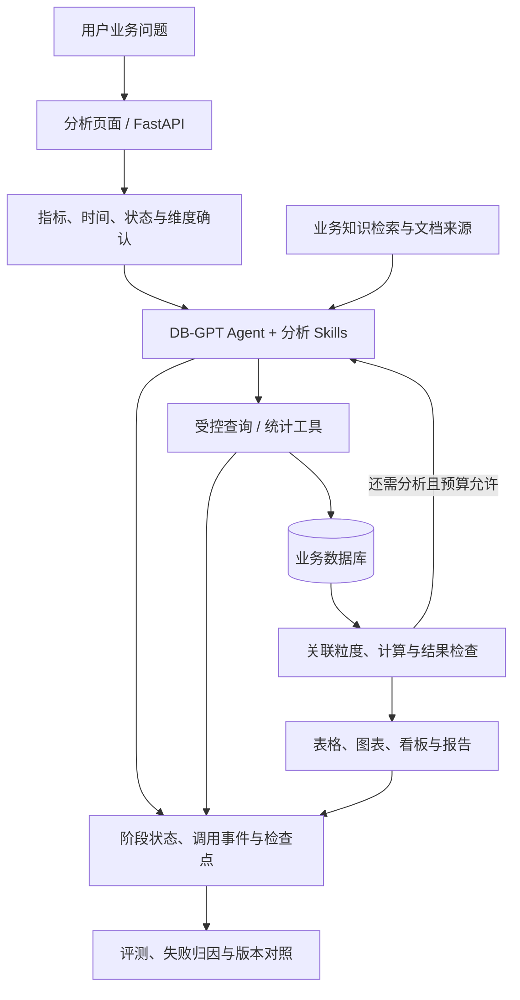

# DataTrail：经营数据分析与证据追踪 Agent

版本：2026-11-07。项目状态：底座已建立独立开发分支，数据诊断已实现；模型链路与完整服务正在准备，后续功能按下文分阶段实施。

结合 DSH 第二版建议的补充决策见 [DSH_V2_REVIEW.md](DSH_V2_REVIEW.md)：新主项目继续实施，现有 Repo Coding Runtime 保留为副项目；不新增第二个全新系统，不设固定 16 周硬排期。后续能力按验证价值决定。

## 1. 一句话定位

基于 DB-GPT 构建的经营分析助手：将用户的业务问题转成有明确口径的查询和多步分析，结合业务文档，生成可追溯的图表、看板与报告，并记录执行过程、检查计算错误及支持失败复盘。

主要用户是运营、经营分析和技术支持人员。目标岗位为 Python 后端、大模型应用和 Agent 开发。

## 2. 相比原项目的变化

原 PaperTrail 面向论文和技术文档，原 Repo Coding Runtime 面向代码仓库。新项目将真实业务问题、关系数据库、多表 SQL、文档知识、图表报告与任务交付连成一个用户流程。它有更广的业务与数据库能力展示空间。

这不表示当前已经比旧项目完成度更高，也不以开源仓库规模推断候选人能力。项目价值来自完整交付、理解深度和实际改造结果。上游已有能力可以展示为整套产品能力；简历和面试中分别说明底座提供什么、本人接通和修改什么。

## 3. 为什么选择 DB-GPT

上游：https://github.com/eosphoros-ai/DB-GPT

固定提交：`9d50d0a55071a040a8cb7684b3b6acfa13cc7c47`。

选择依据：

- 核心后端为 Python，贴近已有语言与服务开发积累。
- 已具备数据源、SQL、Agent 工具、Skills、知识接入、图表和报告等模块，适合形成完整应用。
- 已有 Olist 下载校验、导入、参考查询与指标说明，能更快建立可核查的数据基础。
- 可在真实模块中增加诊断、上下文和执行策略，逐项比较改造效果。
- 数据层先使用 SQLite 即可验证；没有先训练模型或购买 GPU 的必要。

取舍：仓库规模大、依赖复杂，不完整重写底座。先打通一条分析链路，再修改与目标直接相关的模块。底座无法稳定运行时，保留同一业务合同、数据与评测，采用薄的服务实现，而不是重新选题。

已核查的相关入口：

| 层 | 底座入口 | 用途 |
|---|---|---|
| 服务 | `packages/dbgpt-app/src/dbgpt_app/openapi/api_v1/agentic_data_api.py` | Agent 请求、工具组织和流式响应 |
| 查询 | 同目录 `tools/sql_query.py` | 数据查询、超时、输出控制和执行捕获 |
| SQL 检查 | 同目录 `dashboard/sql_security.py` | AST 解析、只读约束、参数处理 |
| 报告 | 同目录 `tools/report_evidence.py`、`report_binding.py` | 结果证据与报告绑定 |
| 数据 | `examples/dashboard/olist/` | 公开数据、加载与参考答案 |
| 业务定义 | `examples/olist/olist-analytics-metric-governance.md` | 指标、时间、状态与粒度约定 |
| 页面 | `web/` | Next.js / React / TypeScript 交互与可视化 |

上述是已存在的底座能力，不代表全部已在本开发环境运行通过。

## 4. 用户任务与功能范围

### 第一阶段：问数与可复查结果

- 查询商品金额、支付金额、订单量和客单价等少量明确定义的指标。
- 按月份、地区、品类进行聚合和对比。
- 展示 SQL、时间范围、状态过滤和实际查询结果。
- 模糊问题追问，数据不支持的问题明确说明。
- 记录错误、调用与结果；优先诊断多表关联对金额和订单粒度的影响。

示例：“比较两个月已交付订单的商品金额、订单量和客单价，看看变化主要来自哪些地区。”

### 第二阶段：分析与图表报告

- 根据中间结果选择下一步查询，有限次数下钻。
- 用 pandas 进行有明确输入的统计，使用底座图表/报告交付。
- 检查分项与总量、报告数字与查询证据是否一致。
- 将变化贡献、相关性和原因假设分开表述。

### 第三阶段：业务文档与工程融合

- 检索指标文档、业务说明和操作规范，统一展示文档来源与 SQL 证据。
- 多步任务阶段状态、失败分类、超时预算、检查点与恢复。
- 保存历史报告；用固定任务发现改动造成的退化。
- 数据源授权和查询约束从现有扩展点接入，按具体访问矩阵验收。

### 第四阶段：反馈驱动迭代

- 从失败轨迹提取候选分析经验，标注版本和适用条件。
- 对一个 Skill 或上下文策略做人工改进与自动改进对照。
- 根据封存任务结果决定接受、撤销或继续试验。
- Hermit/GEPA 为可选实验工具，不是第一版运行的必要依赖。

## 5. 预计技术选型

| 责任 | 技术 | 决策 |
|---|---|---|
| 后端 | Python、FastAPI、Pydantic | 沿用 DB-GPT 服务接口 |
| 模型 | OpenAI-compatible API | 先固定一个实际可用模型；模型名与参数记入实验 |
| Agent | DB-GPT Agent/ReAct、Tool Calling、Skills | 先使用已有运行时，避免叠加第二套框架 |
| 业务数据 | SQLite、SQLAlchemy；后续按需要接 MySQL | 先完成一个数据库，再验证方言迁移 |
| 结构与查询 | Schema 描述、SQLGlot、只读账号/连接、查询预算 | 解析限制和业务正确性分别处理 |
| 统计 | SQL、pandas | 精确计算交给可复查执行结果 |
| 知识检索 | DB-GPT 知识接口、Embedding、混合检索/重排按任务需要 | 初期沿用可运行方案；Qdrant 是旧积累，不强制替换底座存储 |
| 前端 | 底座 Next.js、React、TypeScript、图表组件、流式响应 | 优先接通现有页面，再修改分析详情与历史任务 |
| 状态与观测 | 阶段状态、SQL/工具事件、任务持久化、usage 与耗时 | 先本地留档，再按需接 Langfuse 等服务 |
| 外部工具 | MCP | 有独立工具服务或跨应用复用需求后接入 |
| 验证 | pytest、数据不变量、独立参考计算、逐题对照 | 数据、工具合同、模型任务分层统计 |
| 部署 | 独立 Python 环境；后续 Docker Compose | 完整服务跑通后验证干净环境部署 |

## 6. 底层执行架构

模型负责选择和解释，程序负责执行约束、状态记录与明确可判定的检查。诊断未知或超出支持范围时，给出风险或追问，不把提示词称为任意 SQL 的正确性证明。

## 7. 旧项目的融合方案

迁移方式以适配设计和选择性模块复用为主；下表目前是代码核查后的迁移计划，不代表已经迁入完成。

| 原积累与已查看入口 | 新项目用途 | 实施方式 |
|---|---|---|
| PaperTrail `app/services/evidence.py` | 将报告陈述区分为查询事实、文档支持、分析假设、证据不足 | 适配证据结构；不把关键词支持分数直接用于判定数值正确 |
| PaperTrail `agent_run_store.py` | 任务历史、报告保存和失败复盘 | 复用结构思路，接入底座已有执行产物，避免双份状态权威 |
| PaperTrail `ingestion_store.py` | 业务文档更新、任务租约和内容去重 | 仅在异步文档导入需要时移植相应机制 |
| PaperTrail `evaluation.py` / Bad Case 经验 | 任务集、失败类型与前后对照 | 重新定义结果级指标；词面重叠不用于判断金额正确 |
| Runtime `pico/execution_policy.py` | 限制无效探索、重复查询、修复次数和结束条件 | 将代码编辑阶段改为发现/查询/诊断/交付的分析阶段策略 |
| Runtime `task_state.py`、`checkpoint.py` | 阶段状态、检查点与恢复 | 与底座持久化和会话生命周期对接；记录数据快照/版本变化 |
| Runtime `context_manager.py` | 长工具结果卸载、摘要与按需回读 | 保留 SQL、口径和结果引用；避免摘要丢失过滤条件 |
| Runtime 工具边界与回归 | 数据源授权、受控工具、失败注入 | 使用底座扩展点；只迁移分析场景需要的约束 |

第一轮优先：分析轨迹/失败归因与多表数据诊断。恢复、长期记忆和异步导入在基础任务稳定后推进。

## 8. 亮点与面试优势

整体产品可展示：业务问数、知识增强、多步分析、图表报告、工具执行和工程交付。个人改造则围绕实测失败、明确代码和独立评测来讲。

- 业务清楚：输入和输出易于理解，能完整演示一项经营任务。
- 数据库能力更充分：可现场解释关联基数、聚合、时间边界与指标定义。
- Agent 原理有具体落点：为什么继续查询、什么时候停止、失败如何恢复。
- 旧积累可延续：证据、状态、预算和诊断从原项目迁移到新业务。
- 持续学习有证据：保存最初误解、小样本推导、代码修改、对照结果和退化解释。

“避免千篇一律”主要依靠具体业务取舍、真实失败和本人理解，不承诺选定某个仓库便天然稀缺。上游能力可展示，也需要能解释其实现与本人工作边界。

## 9. 实验与完成标准

最小对照为 A 上游、B 上游加已有业务文档、C 加本人机制。执行模型、数据与预算可比，额外优化成本单独记录。改造前封存留出任务，参考答案不进入生成或修复上下文。

数据来源分开：仓库自带 `synthetic_demo` 用于受控反例；公开 Olist 经下载校验、导入与参考查询核验后用于真实数据层实验。两者不拼接成一个效果数字。

至少覆盖正确查询、自然模型错误、构造错误、歧义追问、空数据、时间边界、状态过滤和多明细/多支付；逐题记录正确、修复、误拦截、退化、耗时和 usage。

目前完成：独立工作目录、只读预检、真实源码入口核查、公开数据复现、本地前后端部署、关联放大诊断工具、SQL 粒度复核及经营工作台。完整模型基线与旧项目迁移模块尚待实施。部署入口及真实完成边界见 [DATATRAIL.md](DATATRAIL.md)。

2026-11-07 本轮运行记录：

- 建立独立 Python 环境；导入经上游清单校验的公开 Olist 八张表，其中订单 99,441 条、商品明细 112,650 条、支付记录 103,886 条。
- 上游 `verify_olist.py` 七组参考查询均与其固定答案匹配。这是数据复现检查，不等于已独立证明所有口径正确，更不是自然语言任务准确率。
- 新增关联诊断的五项针对性测试通过，代码检查通过。
- 在相同“已交付且有商品/支付记录”的 96,477 个订单范围内，商品金额原始汇总为 13,221,363.14，直接关联支付记录后为 13,813,828.71；共有 2,875 个订单的商品行在该关联中重复。
- 上述为手写 SQL 的数据反例，不能写成模型错误率或改造提升；诊断现已注册为 Agent 工具，但自然模型调用效果仍待有效接口验证。
- 公开数据与合成数据诊断产物分别为 `output/commerce-audit/public-joins.json`、`synthetic-joins.json`。

## 10. 接下来的实施顺序

1. 建立隔离环境，核验公开数据；把合成数据与公开数据明确分开。
2. 接通底座模型与一条自然语言查询，固定开发题及留出任务。
3. 测 A/B 基线，确定最值得改的一类问题。
4. 接入有边界的诊断和分析策略，迁移必要的旧项目能力，测 C。
5. 完成页面演示、报告、历史轨迹与部署文档。
6. 依据真实失败继续迭代，再决定 Memory / MCP / 自动 Skill 优化。
