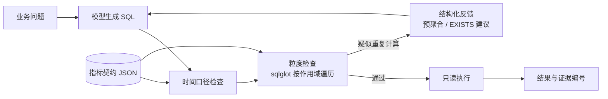

# DataTrail · 电商经营分析 Agent

用自然语言问经营数据，Agent 生成 SQL 并给出分析结果。DataTrail 关注一类不会报错的错误：SQL 能跑通，金额却因为多表关联被重复计算。指标口径和关联粒度写成可配置的契约，SQL 执行前按契约检查，发现问题就退回给模型改写。Agent、图表和报告能力来自 [DB-GPT](https://github.com/eosphoros-ai/DB-GPT)，新增部分见下表。

## 要解决的问题

在 [Olist](https://www.kaggle.com/datasets/olistbr/brazilian-ecommerce) 公开电商数据里，一笔订单可以有多条商品明细，也可以有多条支付记录。把两张明细表按 `order_id` 直接关联后再 `SUM(price)`，数据库不会报错，结果却是错的：

| 口径 | 96,477 笔已交付订单的商品金额 |
| --- | --- |
| 先按订单分别汇总再关联 | 13,221,363.14 BRL |
| 直接关联支付明细后汇总 | 13,813,828.71 BRL（2,875 笔订单发生重复） |

SQL 安全检查只拦注入和写操作，拦不住这种口径错误。

## 设计



| 模块 | 位置 | 作用 |
| --- | --- | --- |
| 指标契约 | [`commerce_contract.py`](packages/dbgpt-app/src/dbgpt_app/commerce_contract.py)、[`configs/metric_contracts/`](configs/metric_contracts/) | 每个数据库一份 JSON：币种、默认过滤、时间字段、父子表和多对多关联规则 |
| 粒度检查 | [`commerce_grain.py`](packages/dbgpt-app/src/dbgpt_app/commerce_grain.py) | 在同一个 `SELECT` 作用域内判断金额是否被关联放大；追踪 CTE/子查询输出列的金额来源；契约声明的一对一过滤（如只取第一笔支付）不再要求复核；完整预聚合和 `EXISTS` 不受影响 |
| 执行前审查 | [`commerce_review.py`](packages/dbgpt-app/src/dbgpt_app/openapi/api_v1/tools/commerce_review.py) | 串联时间口径与粒度检查，接入 SQL 工具和图表工具 |
| 同轮查询复用 | `DATATRAIL_QUERY_REUSE` | 同一轮内相同的确定性 SQL 只执行一次，含随机或时间函数的不复用 |
| 口径记忆 | [`commerce_memory.py`](packages/dbgpt-app/src/dbgpt_app/commerce_memory.py)、[`tools/metric_memory.py`](packages/dbgpt-app/src/dbgpt_app/openapi/api_v1/tools/metric_memory.py) | 跨会话记住用户确认过的指标口径，见下节 |
| 分析工作台 | `/commerce/` | 展示关联放大诊断，带问题和数据源进入 Agent 页面 |

换一个数据库只需新增一份契约 JSON，检查代码不用改。

### 口径记忆

同一个“GMV”，不同用户的口径可能不同（含不含运费、按下单还是送达时间）。口径记忆把用户确认过的定义带到之后的会话，设置 `DATATRAIL_METRIC_MEMORY_DB` 后启用：

1. 用户在对话里说明口径时，模型调用 `propose_metric_definition`，记录一条结构化的待确认口径（指标名、表达式、时间字段、过滤条件、币种）。模型只能提议，没有确认工具。
2. 用户通过 `POST /api/v1/datatrail/metric-memory/{id}/confirm` 确认后才生效；`/revoke` 撤销。记录保留来源会话、原话和确认时间，撤销和被新口径替代的记录不删除。
3. 新会话生成 SQL 前，按“用户 × 数据库”加载已确认的口径，写进提示词并要求在回答里说明用了哪条记忆。
4. 口径与指标契约冲突（币种不同、时间字段不在契约声明范围内）时拒绝确认；契约之后变化导致冲突的旧记忆不再使用，在提示词里单独列出，以契约为准。

记忆按用户、数据库、指标三元组隔离，同一指标的新确认会替代旧的；确认在 SQLite `BEGIN IMMEDIATE` 事务里完成，16 个并发确认只成功 1 次。没有做向量检索、自动抽取或对话摘要：口径是少量、需要人确认的结构化事实，按键精确取用就够了。

## 验证结果

| 实验 | 结果 |
| --- | --- |
| 外部数据库 [Chinook](https://github.com/lerocha/chinook-database) 6 题冻结评测，未加载契约 | 4/6；2 条注入的重复计算 SQL 都没有被拦截 |
| 同上，加载 `chinook.json` 契约 | 6/6；2 条注入 SQL 在执行前被拦截并由模型改写；4 道正常题（含 `EXISTS`）没有误拦 |
| Olist 20 题：基础 / 加治理文档 / 再加代码检查 | 17/20 / 20/20 / 20/20 |
| Olist 合成扰动 13 条 SQL × 4 个库（离线） | 已知错误漏检 4 条 → 0 条；普通合法查询误报 4/24 → 0/24 |
| [BIRD](https://bird-bench.github.io/) 开发集 `financial` + `student_club` 共 264 条人工标注 SQL（离线） | 复核 1 条，人工核对为误报，约 0.4% |
| 同样 264 题由 DeepSeek 自己写 SQL，比较加守卫前后的执行准确率 | 加守卫前后都是 163/264（61.7%）；答错的 101 题里没有重复累加错误，守卫在自然任务上没有提升 |
| 同一轮 5 次相同 SQL 回放 | 数据库执行从 5 次降到 1 次，结果一致 |
| 口径记忆真实模型检查（Olist，4 个月份 × 4 组，[结果](examples/commerce_audit/metric_memory/RESULTS.json)） | 第一个会话里模型按用户原话一次提出合法口径；新会话加载记忆后 4/4 与口径参考 SQL 结果一致；无记忆、撤销后、换用户三组均 0/4 |
| 相关回归测试 | 170 项通过（含 10 项口径记忆） |

Olist 20 题里，提升来自治理文档，代码检查一次都没有触发，所以这组数字不能算作代码检查的贡献。差异的 3 题都是下单时间和送达时间的口径歧义。代码检查的作用要看 Chinook 的注入实验。Olist 和 Chinook 的题都是作者自己编写，样本量小，不代表任意 SQL 的正确性。

BIRD 扫描测的是误报：标准 SQL 里没有这类重复计算，所以测不到拦截收益。模型自己写 SQL 的实验也没有出现这类错误，说明守卫的价值在已知陷阱和执行前保险，准确率的瓶颈在理解题意和选字段。曾试加 `AVG` 检查，带来 2 条新误报和 1 次答错，已撤回。BIRD 契约只按表结构和数据基数编写，判定由作者人工完成。细节见 [评测 v1](examples/commerce_audit/evaluation_v1/README.md)、[合成扰动](examples/commerce_audit/grain_challenge_v1/README.md)、[外部库评测](examples/commerce_audit/external_v1/) 和 [BIRD 扫描](examples/commerce_audit/external_bird/README.md)。

口径记忆检查里，无记忆的 12 次回答中有 10 次用支付金额 `payment_value`、2 次用商品金额 `price` 算 GMV，时间都按下单时间。也就是说，没有记忆时模型对同一指标的默认口径本身就不稳定。这组检查只验证记忆的写入、生效、撤销和隔离路径，题目是作者针对一个非默认口径编写的，不是准确率评测。线上 Agent 中的加载路径有单元测试和导入检查，没有用完整 UI 跑真实会话。

## 本地运行

需要 Python 3.11、Node.js 和一个 OpenAI 兼容的模型接口（开发时使用 DeepSeek）。在仓库根目录执行：

```powershell
py -3.11 -m venv ../.venvs/commerce-analysis
$env:UV_PROJECT_ENVIRONMENT = (Resolve-Path ../.venvs/commerce-analysis).Path
& ../.venvs/commerce-analysis/Scripts/python.exe -m pip install uv==0.8.22
& ../.venvs/commerce-analysis/Scripts/uv.exe sync --package dbgpt-app --no-dev --no-default-groups --locked
& ../.venvs/commerce-analysis/Scripts/python.exe examples/dashboard/olist/initialize_olist_demo.py
Set-Location web; npm ci --no-audit --no-fund; Set-Location ..
Copy-Item configs/datatrail.env.example .env.local   # 填写模型密钥和地址
./scripts/start-datatrail.ps1
```

打开 <http://127.0.0.1:3000/commerce/>。环境变量、测试命令和实验记录见 [DATATRAIL.md](DATATRAIL.md)。

## 局限

- 粒度检查只识别契约里声明的关联模式，不能证明任意 SQL 正确；合法的金额分摊也可能被要求改写；只来自数据本身的唯一性（例如某个客户恰好只有一条记录）无法从 SQL 判断。只检查 `SUM`，不检查 `AVG`。
- 单机部署，沿用上游的模拟用户身份，没有多租户和行级权限。
- 口径记忆的用户隔离依赖上述用户标识：上游鉴权直接信任 `user-id` 请求头，未带时视为默认用户 `001`。隔离逻辑本身有测试，但身份并不可信，真实部署要先接入登录。
- 评测题量小，完整 UI 多工具 Agent 的端到端效果还没有系统评测。

## 许可与上游

基于 DB-GPT 提交 `9d50d0a55071a040a8cb7684b3b6acfa13cc7c47` 构建，遵循 [MIT](LICENSE)。DB-GPT 原始说明见 [UPSTREAM_README.md](UPSTREAM_README.md)。
