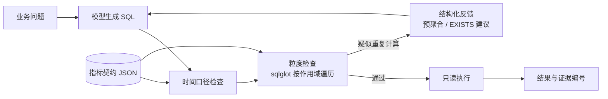

# DataTrail · 电商经营分析 Agent

用自然语言问经营数据，Agent 生成 SQL 并给出分析结果。DataTrail 关注一类不会报错的错误：SQL 能跑通，金额却因为多表关联被重复计算。指标口径和关联粒度写成可配置的契约，SQL 执行前按契约检查，发现问题就退回给模型改写。Agent、图表和报告能力来自 [DB-GPT](https://github.com/eosphoros-ai/DB-GPT)，新增部分见下表。

## 要解决的问题

在 [Olist](https://www.kaggle.com/datasets/olistbr/brazilian-ecommerce) 公开电商数据里，一笔订单可以有多条商品明细，也可以有多条支付记录。把两张明细表按 `order_id` 直接关联后再 `SUM(price)`，数据库不会报错，结果却是错的：

| 口径 | 96,477 笔已交付订单的商品金额 |
| --- | --- |
| 先按订单分别汇总再关联 | 13,221,363.14 BRL |
| 直接关联支付明细后汇总 | 13,813,828.71 BRL（2,875 笔订单发生重复） |

SQL 安全检查只拦注入和写操作，拦不住这种口径错误。

## 设计



| 模块 | 位置 | 作用 |
| --- | --- | --- |
| 指标契约 | [`commerce_contract.py`](packages/dbgpt-app/src/dbgpt_app/commerce_contract.py)、[`configs/metric_contracts/`](configs/metric_contracts/) | 每个数据库一份 JSON：币种、默认过滤、时间字段、父子表和多对多关联规则 |
| 粒度检查 | [`commerce_grain.py`](packages/dbgpt-app/src/dbgpt_app/commerce_grain.py) | 只在同一个 `SELECT` 作用域内判断金额列是否被关联放大；子查询、预聚合 CTE、`EXISTS` 不受影响 |
| 执行前审查 | [`commerce_review.py`](packages/dbgpt-app/src/dbgpt_app/openapi/api_v1/tools/commerce_review.py) | 串联时间口径与粒度检查，接入 SQL 工具和图表工具 |
| 同轮查询复用 | `DATATRAIL_QUERY_REUSE` | 同一轮内相同的确定性 SQL 只执行一次，含随机或时间函数的不复用 |
| 分析工作台 | `/commerce/` | 展示关联放大诊断，带问题和数据源进入 Agent 页面 |

换一个数据库只需新增一份契约 JSON，检查代码不用改。

## 验证结果

| 实验 | 结果 |
| --- | --- |
| 外部数据库 [Chinook](https://github.com/lerocha/chinook-database) 6 题冻结评测，未加载契约 | 4/6；2 条注入的重复计算 SQL 都没有被拦截 |
| 同上，加载 `chinook.json` 契约 | 6/6；2 条注入 SQL 在执行前被拦截并由模型改写；4 道正常题（含 `EXISTS`）没有误拦 |
| Olist 20 题：基础 / 加治理文档 / 再加代码检查 | 17/20 / 20/20 / 20/20 |
| 同一轮 5 次相同 SQL 回放 | 数据库执行从 5 次降到 1 次，结果一致 |
| 相关回归测试 | 151 项通过 |

Olist 20 题里，提升来自治理文档，代码检查一次都没有触发，所以这组数字不能算作代码检查的贡献。差异的 3 题都是下单时间和送达时间的口径歧义。代码检查的作用要看 Chinook 的注入实验。两组题都是作者自己编写，样本量小，不代表任意 SQL 的正确性。细节见 [评测 v1](examples/commerce_audit/evaluation_v1/README.md) 和 [外部库评测](examples/commerce_audit/external_v1/)。

## 本地运行

需要 Python 3.11、Node.js 和一个 OpenAI 兼容的模型接口（开发时使用 DeepSeek）。在仓库根目录执行：

```powershell
py -3.11 -m venv ../.venvs/commerce-analysis
$env:UV_PROJECT_ENVIRONMENT = (Resolve-Path ../.venvs/commerce-analysis).Path
& ../.venvs/commerce-analysis/Scripts/python.exe -m pip install uv==0.8.22
& ../.venvs/commerce-analysis/Scripts/uv.exe sync --package dbgpt-app --no-dev --no-default-groups --locked
& ../.venvs/commerce-analysis/Scripts/python.exe examples/dashboard/olist/initialize_olist_demo.py
Set-Location web; npm ci --no-audit --no-fund; Set-Location ..
Copy-Item configs/datatrail.env.example .env.local   # 填写模型密钥和地址
./scripts/start-datatrail.ps1
```

打开 <http://127.0.0.1:3000/commerce/>。环境变量、测试命令和实验记录见 [DATATRAIL.md](DATATRAIL.md)。

## 局限

- 粒度检查只识别契约里声明的关联模式，不能证明任意 SQL 正确；合法的金额分摊也可能被要求改写。
- 单机部署，沿用上游的模拟用户身份，没有多租户和行级权限。
- 评测题量小，完整 UI 多工具 Agent 的端到端效果还没有系统评测。

## 许可与上游

基于 DB-GPT 提交 `9d50d0a55071a040a8cb7684b3b6acfa13cc7c47` 构建，遵循 [MIT](LICENSE)。DB-GPT 原始说明见 [UPSTREAM_README.md](UPSTREAM_README.md)。
